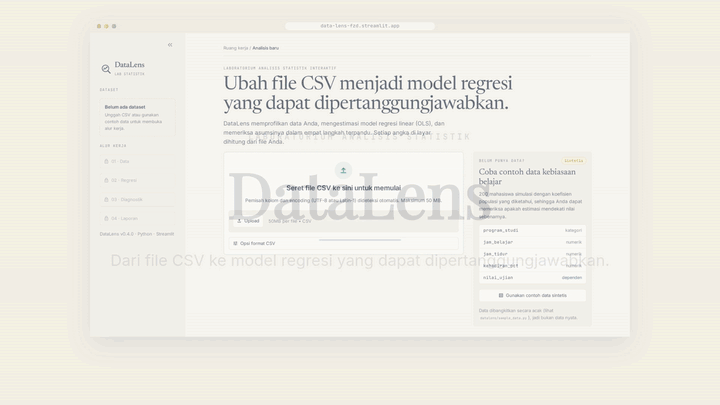

# DataLens — Interactive Statistical Analysis Lab

[](https://data-lens-fzd.streamlit.app/)
[](https://github.com/favianzd/data-lens/actions/workflows/tests.yml)

[](LICENSE)

DataLens is a Streamlit app for uploading a CSV, exploring it, and fitting linear regression models with
honest, well-explained inference. Every number on screen is computed from the uploaded data by
statsmodels/NumPy. Nothing is mocked. The UI explanations are in Indonesian and use standard
statistical terminology.

**Try it live:** <https://data-lens-fzd.streamlit.app/>. No sign-up needed. Click **Gunakan contoh data
sintetis** to explore with sample data.



> **Status: v0.4, deployed.** It covers CSV upload, a data profile, exploratory statistics, OLS inference,
> regression diagnostics, model comparison with repeated k-fold cross-validation, and a downloadable HTML
> report. It runs on Streamlit Community Cloud. See [DEPLOYMENT.md](DEPLOYMENT.md).

## How it works

DataLens is a guided four-step workflow. Loading a dataset unlocks Data and Regresi; fitting a model
unlocks Diagnostik and Laporan.

| Step | What you do | What DataLens computes |
|---|---|---|
| **01 · Data** | Upload a CSV (`,` or `;` separators and UTF-8/Latin-1 are detected automatically), or load the sample data | Size, column types, missing values and duplicates, descriptive statistics, distributions, and Pearson/Spearman correlations |
| **02 · Regresi** | Choose Y and one or more predictors | OLS with coefficients, SEs, CIs, p-values, R² / adjusted R², F-test and AIC/BIC. A **Perbandingan model** tab compares two models with repeated k-fold cross-validation |
| **03 · Diagnostik** | Review the checks | Residual, Q-Q and scale-location plots first, then RESET, Breusch–Pagan, Shapiro–Wilk/Jarque–Bera, VIF and influence |
| **04 · Laporan** | Read the summary and export it | A self-contained HTML report and a coefficient CSV, both built from the same results shown on screen |

## Quick start

Requires **Python 3.12+**. It was developed on 3.14, and CI tests 3.12–3.14.

```bash
git clone https://github.com/favianzd/data-lens.git
cd data-lens
python -m venv .venv
.venv\Scripts\activate          # macOS/Linux: source .venv/bin/activate
pip install -r requirements-dev.txt
streamlit run app.py
pytest
```

No CSV at hand? Click **Gunakan contoh data sintetis** on the welcome screen. It loads a generated dataset whose
population coefficients are documented in `datalens/sample_data.py`.

## Project structure

```
app.py                  Streamlit entry: sidebar step navigation + routing to the active step
views/                  One module per screen: welcome, data_page (overview + explore), regression
                        (+ comparison tab), diagnostics, report. state.py holds the step rules,
                        ui.py the design-system CSS and HTML helpers. Each screen renders inside
                        an error boundary
datalens/
  data.py               CSV loading (delimiter sniffing, encoding fallback) and dataset profile
  eda.py                Descriptive statistics, correlation matrix (+ pairwise n), histogram bins
  regression.py         Input validation + OLS via statsmodels → RegressionResult
  diagnostics.py        Residuals, influence, Q-Q, assumption tests, VIF → Diagnostics
  comparison.py         Two-model comparison: in-sample fit, nested F, repeated k-fold CV
  plots.py              Plotly figures drawn from the results above (no Plotly-side statistics)
  report.py             Self-contained HTML report built from the same result objects
  formatting.py         Number / p-value formatting shared by UI and report
  sample_data.py        Synthetic demo dataset with known coefficients
tests/                  pytest suite (synthetic data, NIST reference, edge cases, headless app test)
.streamlit/config.toml  Theme (colours, fonts, radii), upload limit, telemetry off
.github/workflows/      CI: pytest on Python 3.12 / 3.13 / 3.14
docs/demo.gif           README demo, cut from screenshots of the live app
DEPLOYMENT.md           Community Cloud deployment, runtime pinning, operating notes
LICENSE                 MIT
```

The statistical core (`datalens/`) never imports Streamlit, so the tests and the report generator call it
directly.

## Statistical decisions

| Decision | Choice | Why |
|---|---|---|
| Estimator | OLS with intercept, `statsmodels.OLS` | Established library; inference is never hand-rolled. |
| Standard errors | Classical (non-robust) | Textbook default. The Diagnostik step shows when this is questionable. Robust (HC3) SEs are not implemented yet. |
| Missing values | Complete-case (listwise deletion) on **model columns only** | Transparent and simple. Dropped rows are counted and reported. Unbiased under MCAR or when missingness depends only on predictors. Can be biased when it depends on Y. |
| ±inf values | Dropped and counted separately from NaN | Keeps invalid numbers from passing silently into the fit. |
| Scaling | None. Variables are used in their original units | Each slope keeps its "per one unit of X" meaning. |
| Categorical / boolean predictors | Rejected for now | Avoids implicit dummy coding with an unclear reference level. |

### Exploratory statistics

| Statistic | Definition used |
|---|---|
| SD | Sample SD (ddof = 1) |
| Quartiles / IQR | Linear interpolation (Hyndman & Fan type 7, pandas/NumPy default) |
| Skewness, kurtosis | Bias-adjusted sample estimators. Kurtosis is *excess* (normal = 0) |
| Outlier flag | Tukey fences Q1 − 1.5·IQR, Q3 + 1.5·IQR (flag to inspect, never auto-removed) |
| Histogram bins | NumPy `"auto"` (max of Sturges, Freedman–Diaconis), capped at 100 bins |
| Correlation | Pearson or Spearman, **pairwise deletion** with per-cell n shown. r is not computed below 3 pairs or for zero-variance columns |

Correlation p-values are deliberately not shown, because screening every pair inflates false positives.
Histogram counts and box-plot quartiles are computed in `datalens/` and passed to Plotly, so the chart
always matches the table.

### Diagnostics

Plots come first, and formal tests are labelled as supporting evidence. A test with p ≥ α is reported as
"not enough evidence to reject H0. This is not evidence that the assumption holds." There is a unit test
for that wording.

| Assumption | Visual | Formal test |
|---|---|---|
| Linearity | Residuals vs fitted + LOWESS | Ramsey RESET (ŷ², ŷ³, F-test). Skipped when residual df is too small |
| Constant variance | Scale-location + LOWESS | Breusch–Pagan, Koenker studentized (robust to non-normal errors) |
| Normal errors | Q-Q plot (line through Q1–Q3), residual histogram | Shapiro–Wilk (n ≤ 5000), Jarque–Bera above that |
| Independence | — | Durbin–Watson statistic only, flagged as meaningful only when row order means something |
| Multicollinearity | — | VIF (5 / 10 rule-of-thumb bands), Belsley condition number on unit-scaled design |
| Influence | Cook's distance plot | Flags: Cook's D > 4/n, leverage > 2p/n, \|external studentized residual\| > 3 |

The app adds notes when n < 30 (low power) or n ≥ 1000 (tests flag trivial deviations). Externally
studentized residuals use the exact closed form rather than statsmodels' n leave-one-out refits, which
took ~10 s at n = 10,000.

### Model comparison

- Both models and an intercept-only baseline are scored on **the same rows**: complete cases over the
  union of their columns.
- **Repeated k-fold CV** (default 5 × 10, fixed seed) uses identical splits for every model, so per-split
  differences are paired. RMSE and MAE are reported as mean ± SD across splits. The SD is *not* a standard
  error, because folds overlap.
- **No leakage**: each model is a scikit-learn `Pipeline` cloned and refit inside every training fold.
  Listwise deletion is a per-row rule, so applying it before splitting leaks nothing. Any future learned
  preprocessing (scaling, imputation) must go inside the pipeline.
- Each training fold must have more rows than the larger model has parameters. Training folds with a
  singular design are counted and reported.
- In-sample R², adjusted R², AIC and BIC sit beside CV error, plus a partial F-test when the models are nested.

### Analysis report

The **Laporan** step builds one HTML file with these sections: dataset summary, model specification and
coefficient table, main findings, diagnostics (plots, tests, VIF, influence), optional model comparison,
and limitations.

- **No retyped numbers.** Every value is read from `RegressionResult` / `Diagnostics` / `ComparisonResult`
  and formatted by `formatting.py`. Key values carry a `data-key` attribute, and `tests/test_report.py`
  parses the HTML and checks each one against the underlying result.
- **Rule-based wording.** Findings use association language ("berasosiasi", never "menyebabkan") and state
  whether each CI contains zero. Limitations are added only when the data triggers them: for example, the
  heteroscedasticity caveat appears only if Breusch–Pagan rejects, the VIF caveat only if VIF ≥ 10, and
  every model warning and skipped test is carried over.
- **Self-contained and safe.** Plotly.js is embedded once (~4.8 MB) so figures work offline. Unchecking
  "Sertakan grafik" gives a report of about 15 KB with no scripts. All user-supplied text (file and column
  names) is HTML-escaped, and a test checks this with `<script>` column names.
- **Timestamps in WIB.** The deployed server runs on UTC, so the report's "Dibuat …" line and the
  download filename (`…_YYYYMMDD_HHMM_WIB.html`) are converted to Western Indonesia Time (UTC+7) and
  labelled, whatever the server clock says.
- A coefficient table CSV is also downloadable.

### Validation before fitting

`fit_ols` raises `ModelSpecError` with an Indonesian message, and never returns NaN-filled output, for:

- no predictors, duplicate predictors, target used as a predictor, missing or non-numeric columns
- no complete rows, or `n ≤ p` (needs residual df ≥ 1)
- a constant target or constant predictor, **checked after** listwise deletion
- a singular design (perfect multicollinearity). The redundant column is named, found by an
  incremental rank test on unit-scaled columns.

It returns **warnings** (not errors) for dropped rows, fewer than 10 observations per predictor (a rule of
thumb), and a perfect fit where the standard errors carry no meaning.

## How correctness is verified

`tests/test_regression.py` checks:

- **Hand-computed textbook example**: b₀ = 2.2, b₁ = 0.6, R² = 0.6.
- **NIST StRD Longley** certified coefficients, standard errors, R² and residual SD (an ill-conditioned
  reference problem).
- **Independent NumPy/SciPy computation** of coefficients, SEs, t, p, CIs, R², adjusted R² and residual SE.
- **Known-coefficient synthetic data**: estimates recover β, and R² ≈ its population value 12/13.
- Missing/inf handling, plus every validation error and warning listed above.

`tests/test_eda.py` checks descriptives against NumPy/SciPy (`np.percentile`, `scipy.stats.skew/kurtosis`),
Pearson/Spearman against `scipy.stats` under pairwise deletion, known cases (r = −1; Spearman = 1 for a
monotone nonlinear relation), constant columns, and that the plotted histogram counts, box quartiles and
heatmap cells equal the computed values.

`tests/test_diagnostics.py` checks leverage, standardized and studentized residuals and Cook's D against
hat-matrix formulas in NumPy, VIF against auxiliary regressions, and Breusch–Pagan against Koenker's
n·R² computed by hand. It checks that each test detects a planted violation (heteroscedastic, heavy-tailed,
quadratic data), covers tiny-sample and perfect-fit edge cases, and confirms the plotted values equal the
computed ones.

`tests/test_comparison.py` checks CV RMSE/MAE against `sklearn.model_selection.cross_val_score` with
the same splitter, the nested F-test against `statsmodels.anova_lm`, and same-row scoring. It covers a
relevant predictor lowering CV error, a pure-noise predictor raising R² without improving CV error,
fold-size validation, and rank-deficient fold warnings.

`tests/test_report.py` checks that every tagged value in the generated HTML (coefficients, fit statistics,
descriptives, test statistics, VIF, CV metrics) equals the underlying result. It also checks that findings
use association language and limitations appear only when triggered, and covers HTML escaping, reports
with and without figures, the perfect-fit case (diagnostics unavailable), and safe filenames.

`tests/test_app.py` runs `app.py` headlessly with Streamlit's `AppTest`. It loads the sample data, fits a
model, renders diagnostics, runs a comparison and builds a report, and fails on any exception or
error-boundary message.

## Roadmap

1. ~~Vertical slice: upload → OLS → coefficients & R²~~
2. ~~EDA: descriptive statistics, distributions, correlation heatmap (Plotly)~~
3. ~~Diagnostics: residual plots, Q-Q plot, VIF, formal assumption tests, influence~~
4. ~~Model comparison: in-sample fit, nested F-test, repeated k-fold CV RMSE/MAE~~
5. ~~Report export (HTML) generated from the same result objects; per-tab error boundary~~
6. ~~Deployment: pinned runtime, CI, headless app test, live on Streamlit Community Cloud~~

### Next

Ordered roughly by value for effort:

- **Robust standard errors (HC3)** as a toggle. The diagnostics already flag heteroscedasticity, and the
  report already suggests HC3.
- **Prediction panel**: enter predictor values and get both a confidence interval for the mean and a
  prediction interval for a single new observation.
- **Influence sensitivity**: refit without the flagged observations and show the coefficients side by side.
- **Categorical predictors** with explicit dummy coding and a user-chosen reference level.
- **Transformations and interactions** (log, square, `x1×x2`), with interpretations that update to match.
- **Multiple imputation** next to complete-case results.
- Logistic regression, a hypothesis-test module (t-test, ANOVA, chi-square), and an English UI toggle.

## Known limitations

- Numeric predictors only; no interactions, transformations or categorical encoding yet.
- Complete-case analysis only (no imputation).
- Classical (non-robust) standard errors only.
- Influential observations are flagged, but refitting without them is a manual step.
- The interface is in Indonesian only.
- Associations only: nothing in this tool supports causal claims.

## License

[MIT](LICENSE) © 2026 favianzd
